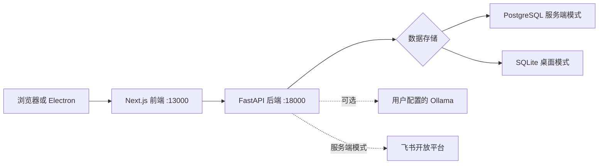

# Fly Arrangement · 项目与客户协同管理

**Fly Arrangement** 是一套面向 Windows 桌面和自托管环境的项目、客户与日程管理应用，提供 FastAPI 后端、Next.js 前端，以及可选的 Electron 桌面壳。AI 助手可连接用户配置的 Ollama 服务；飞书机器人适用于服务端部署。

**English:** A self-hosted project, customer, and calendar management app with an optional local AI assistant and Windows desktop shell.

## 功能

- 项目和客户资料管理、负责人协作、项目治理与修复队列
- 日历、提醒、自然语言日程建议
- AI 助手，可调用项目、客户、日程和提醒工具
- 用户与角色管理、登录、审计日志和数据维护
- 服务端飞书机器人与消息同步
- Windows Electron 桌面模式，使用本地 SQLite 数据库

## 架构



## 运行方式

| 方式 | 数据库 | 适用场景 |
|---|---|---|
| Docker Compose | PostgreSQL | 自托管 Web 服务 |
| Windows / Electron | SQLite | 单机桌面使用 |
| 本地开发 | SQLite 或 PostgreSQL | 开发前后端和桌面壳 |

## Docker Compose 快速启动

需要 Docker Desktop 和 Docker Compose。项目默认只监听本机地址；数据库端口 `15432` 也只绑定到 `127.0.0.1`。

1. 创建本地环境文件：

   ```powershell
   if (-not (Test-Path .env)) { Copy-Item .env.example .env }
   ```

2. 使用密码管理器或 Python 生成随机值，填入 `.env` 的 `POSTGRES_PASSWORD` 和 `JWT_SECRET_KEY`。例如：

   ```powershell
   python -c "import secrets; print('POSTGRES_PASSWORD=' + secrets.token_hex(24)); print('JWT_SECRET_KEY=' + secrets.token_urlsafe(48))"
   ```

   `POSTGRES_PASSWORD` 建议使用上面生成的十六进制值，避免连接字符串中的特殊字符需要转义。

3. 启动服务并创建首个管理员：

   ```powershell
   docker compose up --build -d
   docker compose exec backend python scripts/create_admin.py
   ```

   创建命令会交互式询问用户名和至少 12 个字符的密码。应用不会再自动创建已知默认口令。

4. 打开前端：<http://localhost:13000>

停止服务时运行 `docker compose down`。该命令会保留数据库卷；不要使用 `docker compose down -v`，除非确实要删除数据库数据。

如需允许局域网访问，可在 `.env` 中将 `APP_BIND_ADDRESS` 设为 `0.0.0.0`，并自行配置防火墙、访问控制和 HTTPS。不要将数据库端口公开到互联网。

## 本地开发

### 后端

需要 Python 3.11 或更高版本。

```powershell
cd backend
python -m venv .venv
.\.venv\Scripts\Activate.ps1
pip install -r requirements.txt
if (-not (Test-Path .env)) { Copy-Item .env.example .env }
$env:DATABASE_URL = 'sqlite+aiosqlite:///./data/fly_arrangement.db'
python scripts/init_sqlite_baseline.py
python -m uvicorn app.main:app --reload --host 127.0.0.1 --port 18000
```

另开一个终端创建首个管理员：

```powershell
cd backend
$env:DATABASE_URL = 'sqlite+aiosqlite:///./data/fly_arrangement.db'
python scripts/create_admin.py
```

健康检查地址为 <http://127.0.0.1:18000/health>。

### 前端

需要 Node.js 20。

```powershell
cd frontend
npm ci
Copy-Item .env.local.example .env.local
npm run dev -- --hostname 127.0.0.1 --port 13000
```

打开 <http://127.0.0.1:13000>。

## Windows 桌面版

Electron 开发和打包脚本位于 `desktop/`，运行时准备脚本位于 `packaging/scripts/`。首次开发需安装 Python 3.11、Node.js 20，并准备运行时与前端构建产物：

```powershell
powershell -ExecutionPolicy Bypass -File .\packaging\scripts\prepare_backend_runtime.ps1
powershell -ExecutionPolicy Bypass -File .\packaging\scripts\prepare_node_runtime.ps1
cd frontend
npm ci
npm run build
cd ..\desktop
npm ci
npm start
```

在 Windows 打包机上运行 `npm run dist` 可生成 NSIS 安装包，输出到 `desktop/release/`。本仓库只发布源码和打包脚本，不把安装包、便携运行时、数据库或日志提交到 Git。

已安装桌面版的首个管理员可用随包 Python 运行创建命令，并显式指定 ProgramData 数据库：

```powershell
$python = "$env:ProgramFiles\Fly Arrangement\resources\runtime\backend-venv\Scripts\python.exe"
$script = "$env:ProgramFiles\Fly Arrangement\resources\backend\scripts\create_admin.py"
$database = "sqlite+aiosqlite:///C:/ProgramData/FlyArrangement/data/fly_arrangement.db"
& $python $script --database-url $database
```

## 配置与安全

- 根目录 `.env.example` 用于 Docker Compose；`backend/.env.example` 用于本地后端开发。
- `JWT_SECRET_KEY` 在生产模式下必须是至少 32 个字符的自定义密钥；开发默认值仅供本机开发。
- 不要提交 `.env`、数据库、日志、访问令牌或个人数据。
- 现有数据库中的管理员账号会保留；新数据库需先运行 `create_admin.py`。
- Ollama 地址和模型可在应用内配置；飞书回调需要可从飞书平台访问的服务端 HTTPS 地址，桌面 SQLite 模式不启用飞书 Webhook。

## 文档

- [项目范围](PROJECT_REQUIREMENTS.md)
- [技术栈](TECH_STACK.md)
- [目录说明](DIRECTORY.md)
- [桌面打包方案](docs/DESKTOP_APP_PACKAGING_PLAN.md)
- [桌面构建与安装准备](docs/DESKTOP_BUILD_AND_SETUP_PREP.md)
- [干净 Windows 安装检查清单](docs/DESKTOP_CLEAN_MACHINE_TEST_CHECKLIST.md)
- [飞书服务端检查清单](backend/docs/FEISHU_PRODUCTION_CHECKLIST.md)

## 许可证

本项目采用 [MIT License](LICENSE)。
